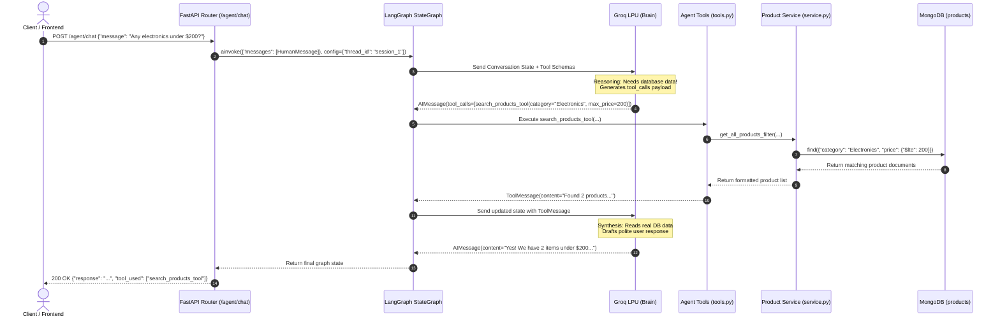
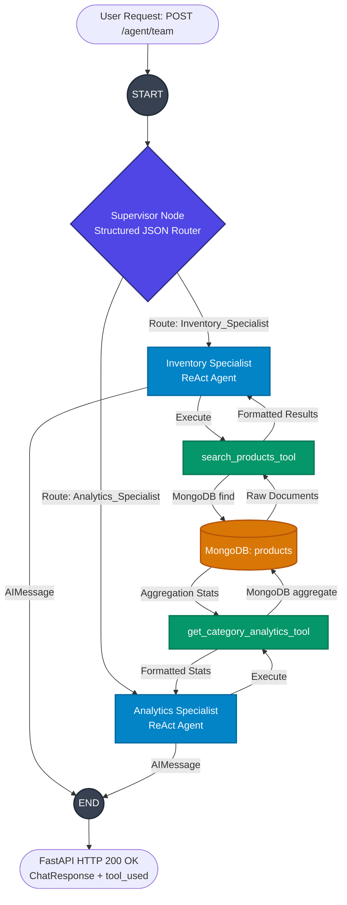

# 🚀 Enterprise FastAPI, MongoDB & LangGraph AI Agent Backend

[](https://fastapi.tiangolo.com)
[](https://www.python.org/)
[](https://www.mongodb.com/)
[](https://langchain-ai.github.io/langgraph/)
[](https://groq.com/)
[](https://www.docker.com/)
[](https://github.com/astral-sh/uv)

A production-ready, modular asynchronous backend powered by **FastAPI**, **MongoDB (Motor)**, and **LangGraph**. Designed with enterprise design patterns, high-performance security standards, and autonomous AI agents capable of conversational memory, live SSE streaming, and human-in-the-loop (HITL) approval workflows.

---

## 📑 Table of Contents

- [Key Architecture & Capabilities](#-key-architecture--capabilities)
- [System Architecture & Agent Flow](#-system-architecture--agent-flow)
- [Repository Structure](#-repository-structure)
- [Tech Stack](#-tech-stack)
- [Getting Started](#-getting-started)
  - [Prerequisites](#prerequisites)
  - [Option A: Local Development with `uv`](#option-a-local-development-with-uv)
  - [Option B: Containerized with Docker Compose](#option-b-containerized-with-docker-compose)
  - [Environment Variables](#environment-variables)
- [API Reference](#-api-reference)
  - [Authentication & Users](#1-authentication--users)
  - [Products & Aggregations](#2-products--aggregations)
  - [Agentic AI & Multi-Agent Workflows](#3-agentic-ai--multi-agent-workflows)
- [Automated Testing](#-automated-testing)
- [Production Hardening](#-production-hardening)
- [Engineering Log & Deep Dives](#-engineering-log--deep-dives)

---

## 🌟 Key Architecture & Capabilities

### 🔐 1. Authentication & Security
- **Argon2 Password Hashing**: Modern, future-proof password security implemented with `pwdlib[argon2]`.
- **JWT Authorization**: Stateless OAuth2-compliant Bearer token workflow with UTC timestamp expiration.
- **Role-Based Access Control (RBAC)**: Fine-grained permissions distinguishing regular users and administrators, with data ownership checks (`created_by`).
- **Resource Guardrails**: Profile protection via `self_or_admin` dependencies preventing unauthorized access.

### ⚡ 2. High-Performance MongoDB Persistence
- **Full Async I/O**: Completely non-blocking database queries leveraging `motor` (`AsyncIOMotorClient`).
- **Complex Aggregations**:
  - **Relational Joins**: `$lookup` across `products` and `users` with ObjectId type-casting (`$toObjectId`), array unwinding (`$unwind`), and credential stripping (`$project`).
  - **Real-Time Analytics**: `$group` pipelines computing count, average price, min/max price, and inventory stock across categories.
- **Dynamic Search & Filtering**: Regex search, range filters (`$gte`, `$lte`), dynamic sorting, and cursor-based pagination.

### 🤖 3. Autonomous AI Agents & LangGraph Orchestration
- **ReAct Graph Engine**: Autonomous agents built with LangGraph and powered by Groq (`openai/gpt-oss-120b`) for sub-second tool execution and inference.
- **Multi-Turn Contextual Memory**: Stateful sessions backed by LangGraph's `MemorySaver` checkpointer using unique `thread_id` keys.
- **Real-Time SSE Streaming**: Live token-by-token streaming via Server-Sent Events (`/agent/stream`) utilizing `astream_events(..., version="v2")`.
- **Human-in-the-Loop (HITL) Safety Gate**: LangGraph `interrupt()` breakpoint pattern safeguarding destructive write actions (e.g., `delete_product_tool`), paired with admin approval endpoints (`/agent/approve`, `/agent/reject`).
- **Hierarchical Multi-Agent Supervisor**: Specialized supervisor agent (`/agent/team`) that routes user inquiries dynamically between an **Inventory Specialist** and an **Analytics Specialist**.
- **Dynamic File Generation**: Agents export on-demand CSV inventory reports directly to the static file server.

### 🛡️ 4. Enterprise Hardening & Polish
- **Static File & Image Management**: Zero-RAM spooled file streaming with `UploadFile`, unique UUID naming, and automatic disk cleanup for stale/replaced images.
- **Brute-Force & Rate Limiting**: Centralized request throttling powered by `slowapi` returning `429 Too Many Requests`.
- **Custom Profiling Middleware**: `LoggingAndTimingMiddleware` calculating sub-millisecond execution latency (`X-Process-Time`) and assigning correlation IDs (`X-Request-ID`).
- **Non-Blocking Background Tasks**: Asynchronous offloading for welcome emails, security alerts, and audit logging.

---

## 📐 System Architecture & Agent Flow

### 1. The ReAct Agent Loop


### 2. Multi-Agent Supervisor Routing (`/agent/team`)


---

## 📁 Repository Structure

```text
.
├── backend_app/
│   ├── api/
│   │   ├── agent/                 # LangGraph ReAct Agent, HITL, tools & routers
│   │   │   ├── graph.py           # ReAct Agent graph with MemorySaver checkpointer
│   │   │   ├── multi_graph.py     # Multi-Agent Supervisor state graph
│   │   │   ├── router.py          # /agent/chat, /agent/stream, /agent/approve, etc.
│   │   │   ├── schema.py          # Pydantic request/response models
│   │   │   └── tools.py           # Search, analytics, stock updates, export CSV, HITL delete
│   │   ├── product/               # Product domain (Package by Feature)
│   │   │   ├── router.py          # CRUD & image upload endpoints
│   │   │   ├── schema.py          # Product schemas & filter models
│   │   │   └── service.py         # MongoDB queries, joins ($lookup) & aggregations ($group)
│   │   ├── user/                  # User domain (Authentication & profiles)
│   │   │   ├── router.py          # Registration, login & avatar endpoints
│   │   │   ├── schema.py          # User models & token representations
│   │   │   └── service.py         # DB operations, password checks & user mutations
│   │   └── user_agent/            # Dedicated User Agent assistant
│   ├── core/                      # Global infrastructure & settings
│   │   ├── config.py              # Centralized Pydantic BaseSettings (.env loader)
│   │   ├── database.py            # Motor Async MongoDB client connection
│   │   ├── dependencies.py        # Current user & admin auth guards
│   │   ├── limiter.py             # SlowAPI rate limiter setup
│   │   ├── middleware.py          # Performance timing & correlation ID middleware
│   │   └── security.py            # Argon2 password hashing & JWT encoding/decoding
│   ├── static/                    # Public static file storage (avatars, product images, reports)
│   ├── tests/                     # Automated test suite
│   │   ├── conftest.py            # Async test fixtures (httpx.AsyncClient + ASGITransport)
│   │   └── test_api.py            # Endpoint, auth, middleware & analytics test cases
│   ├── .dockerignore              # Docker build exclusions
│   ├── .env.example               # Template environment configuration
│   ├── Dockerfile                 # Ultra-fast container build using Astral uv
│   ├── docker-compose.yml         # Multi-container orchestration (App + MongoDB)
│   ├── main.py                    # Application entrypoint & middleware assembly
│   ├── pyproject.toml             # Project manifest & dependency configuration
│   └── README.md                  # Comprehensive engineering log (Phases 1 - 10)
├── .gitignore                     # Git ignore rules (protects .env & static files)
└── README.md                      # Main project documentation
```

---

## 🛠️ Tech Stack

| Component | Technology | Purpose |
| :--- | :--- | :--- |
| **Framework** | [FastAPI](https://fastapi.tiangolo.com/) | Modern, high-performance async Python web framework |
| **Database** | [MongoDB](https://www.mongodb.com/) / [Motor](https://motor.readthedocs.io/) | Non-blocking asynchronous document database |
| **AI & Orchestration** | [LangGraph](https://langchain-ai.github.io/langgraph/) / [LangChain](https://www.langchain.com/) | Stateful agent loops, supervisors, memory & HITL interrupts |
| **LLM Inference** | [Groq](https://groq.com/) (`openai/gpt-oss-120b`) | Ultra-fast token generation & function calling |
| **Authentication** | [pwdlib[argon2]](https://github.com/frankie567/pwdlib) + [PyJWT](https://pyjwt.readthedocs.io/) | Modern Argon2 password hashing and signed JWT bearer tokens |
| **Rate Limiting** | [SlowAPI](https://slowapi.readthedocs.io/) | IP-based request throttling against brute force |
| **Config & Validation**| [Pydantic v2](https://docs.pydantic.dev/) + `pydantic-settings` | Schema validation and strict environment management |
| **Testing** | [Pytest](https://docs.pytest.org/) + `pytest-asyncio` + [HTTPX](https://www.python-httpx.org/) | Async test suite with in-memory ASGI transport |
| **Containerization** | [Docker](https://www.docker.com/) & Docker Compose | Containerized deployments and local development stack |
| **Package Manager** | [uv](https://github.com/astral-sh/uv) | 10x-100x faster Python package installation |

---

## 🚀 Getting Started

### Prerequisites
- **Python 3.12+**
- **MongoDB** (running locally on port 27017 or via Docker)
- [uv](https://github.com/astral-sh/uv) (recommended) or standard `pip`
- A free **Groq API Key** (from [console.groq.com](https://console.groq.com/keys))

---

### Option A: Local Development with `uv`

1. **Clone the repository**:
   ```bash
   git clone https://github.com/maazkhanmaaz366-arch/Agentic_workflow_fastapi.git
   cd Agentic_workflow_fastapi/backend_app
   ```

2. **Configure environment variables**:
   ```bash
   cp .env.example .env
   # Edit .env and paste your GROQ_API_KEY and SECRET_KEY
   ```

3. **Install dependencies**:
   ```bash
   uv sync
   ```

4. **Run database & start the backend**:
   Ensure MongoDB is running locally, then:
   ```bash
   uv run uvicorn main:app --reload --host 0.0.0.0 --port 8000
   ```

5. **Explore the Interactive Documentation**:
   - **Swagger UI**: [http://localhost:8000/docs](http://localhost:8000/docs)
   - **ReDoc**: [http://localhost:8000/redoc](http://localhost:8000/redoc)

---

### Option B: Containerized with Docker Compose

Spin up the entire stack (FastAPI app + MongoDB database with persistent volume) in one command:

```bash
cd backend_app
docker compose up --build
```

The application will be live at `http://localhost:8000` with MongoDB mounted and connected across the internal Docker bridge network.

---

### 🔑 Environment Variables

Configure your `.env` file based on `.env.example`:

```dotenv
PROJECT_NAME="USER MANAGEMENT SYSTEM"
VERSION="1.0.0"

# MongoDB Connection
MONGO_URL="mongodb://localhost:27017/"
DATABASE_NAME="backend_db"

# JWT Security
SECRET_KEY="your-super-secret-key-change-in-production"
ALGORITHM="HS256"
ACCESS_TOKEN_EXPIRE_TIME=30

# AI Agent Provider
GROQ_API_KEY="gsk_your_groq_api_key_here"
```

---

## 📡 API Reference

### 1. Authentication & Users
| Method | Endpoint | Description | Auth Required |
| :--- | :--- | :--- | :--- |
| `POST` | `/users/` | Register a new user (with Argon2 hashing & welcome email) | Public |
| `POST` | `/users/login` | Login and receive signed JWT Access Token | Public (Rate Limited) |
| `GET` | `/users/me` | Fetch authenticated user profile | Bearer Token |
| `GET` | `/users/` | List and search users with pagination | Bearer Token (Admin) |
| `GET` | `/users/{id}` | Get user by ID | Bearer Token (Self or Admin) |
| `PUT` | `/users/{id}` | Update user details | Bearer Token (Self or Admin) |
| `DELETE`| `/users/{id}` | Delete user account and cleanup avatar | Bearer Token (Self or Admin) |
| `POST` | `/users/{id}/image` | Upload user profile avatar (`.jpg`, `.png`, `.webp`) | Bearer Token (Self or Admin) |
| `DELETE`| `/users/{id}/image` | Remove user profile avatar from disk and DB | Bearer Token (Self or Admin) |

### 2. Products & Aggregations
| Method | Endpoint | Description | Auth Required |
| :--- | :--- | :--- | :--- |
| `POST` | `/products/` | Create product (auto-links creator ID) | Bearer Token |
| `GET` | `/products/` | Filter, search, sort, and paginate products | Public |
| `GET` | `/products/my/products` | Retrieve current user's created products | Bearer Token |
| `GET` | `/products/status` | Real-time category analytics dashboard (`$group`) | Public |
| `GET` | `/products/{id}` | Get product details with joined creator profile (`$lookup`) | Public |
| `PUT` | `/products/{id}` | Update product information | Bearer Token (Owner/Admin) |
| `DELETE`| `/products/{id}` | Delete product and disk image | Bearer Token (Owner/Admin) |
| `POST` | `/products/{id}/image`| Upload product image (auto-replaces previous) | Bearer Token (Owner/Admin) |
| `DELETE`| `/products/{id}/image`| Clear product image without deleting product | Bearer Token (Owner/Admin) |

### 3. Agentic AI & Multi-Agent Workflows
| Method | Endpoint | Description | Auth Required |
| :--- | :--- | :--- | :--- |
| `POST` | `/agent/chat` | Single ReAct agent conversation with session memory (`thread_id`) | Public |
| `GET` | `/agent/stream` | Real-time Server-Sent Events (SSE) token & tool event streaming | Public |
| `POST` | `/agent/team` | Multi-Agent Supervisor: routes queries to Inventory vs Analytics | Public |
| `POST` | `/agent/approve` | **HITL**: Approve paused destructive action (e.g., delete product) | Bearer Token (Admin) |
| `POST` | `/agent/reject` | **HITL**: Reject and safely abort paused action | Bearer Token (Admin) |
| `POST` | `/user_agent/chat` | Specialized User Assistant agent for user directory queries | Public |

---

## 🧪 Automated Testing

The test suite runs with sub-second execution leveraging `httpx.AsyncClient` with `ASGITransport` without needing a live network port:

```bash
cd backend_app
uv run pytest -v
```

### Test Coverage Highlights:
- ✅ Public health check & metadata (`GET /`)
- ✅ Invalid credential handling (`401 Unauthorized`)
- ✅ Protected route token verification
- ✅ Analytics aggregation pipelines (`GET /products/status`)
- ✅ Performance profiling & correlation ID middleware headers (`X-Process-Time`, `X-Request-ID`)

---

## 🛡️ Production Hardening

- **Stateless & Scalable**: Decoupled database and static file layers ensure zero state is tied to server instances.
- **Defensive Error Handling**: Catching `InvalidId` exceptions on malformed MongoDB ObjectIDs and returning clean `400 Bad Request` responses.
- **Zombie File Protection**: Safe disk unlinking (`Path.unlink(missing_ok=True)`) prevents orphan media accumulation on replace or delete.
- **Rate-Limited Critical Endpoints**: Auth routes are protected against brute-force attacks via SlowAPI.

---

## 📖 Engineering Log & Deep Dives

For the full step-by-step engineering journey, architectural decisions, and 30+ production gotchas documented during development, read:
👉 **[backend_app/README.md](backend_app/README.md)**

---

## 👤 Author

**Maaz Khan**  
- GitHub: [@maazkhanmaaz366-arch](https://github.com/maazkhanmaaz366-arch)  
- Email: maazkhanmaaz366@gmail.com
