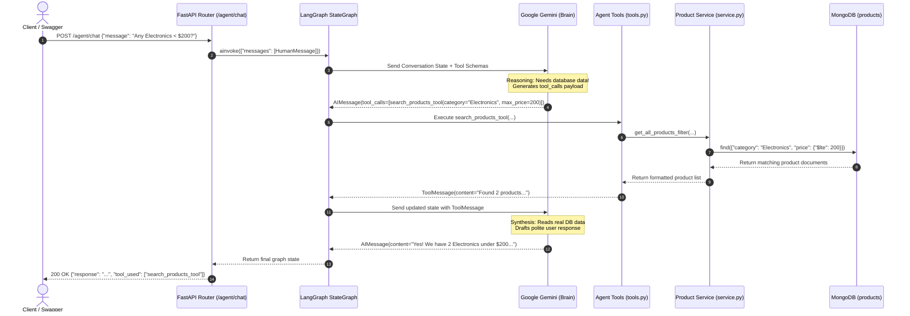
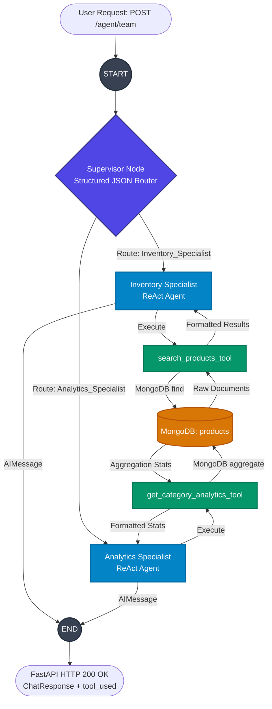

# FastAPI & MongoDB Learning Journey 🚀

A comprehensive record of concepts learned, practical tasks completed, and the upcoming roadmap.

---

## 📌 Phase 1: Core FastAPI Foundations (Completed)

### 1. Pydantic Models & Data Validation
- Defined structured request schemas with `BaseModel`.
- Automatic type validation (`str`, `int`, `float`, `bool`).
- Default values and optional fields (`is_offer: bool = False`, `str | None = None`).
- Converting models to dictionaries using `.model_dump()`.

### 2. Request Parameters
- **Path Parameters**: `@app.get("/items/{item_id}")` — capturing variables directly from the URL.
- **Query Parameters**: `@app.get("/users?limit=10&search=john")` — optional query filtering with defaults.
- **Request Body**: `@app.post("/items")` — handling JSON payloads validated against schemas.

### 3. FastAPI Dependency Injection (`Depends`)
- Built reusable logic and helper functions.
- Injected shared logic into route handlers using `Depends(...)`.

### 4. In-Memory CRUD Milestone
- Built an in-memory database using Python lists and dictionaries.
- Auto-incremented IDs and calculated `passed` status based on marks.

---

## 📌 Phase 2: REST Best Practices (Completed)

1. **REST Path Conventions**: Using plural nouns and path parameters (`/users/{id}`, `/products/{id}`).
2. **Proper HTTP Status Codes**:
   - `201 Created` for resource creation.
   - `400 Bad Request` for malformed IDs or missing payload.
   - `401 Unauthorized` for bad credentials or missing security tokens.
   - `404 Not Found` when a resource does not exist.
   - `405 Method Not Allowed` when calling an endpoint with the wrong HTTP verb.
3. **HTTP Exceptions**: Using `raise HTTPException(status_code=..., detail=...)`.

---

## 📌 Phase 3: Persistent Storage with MongoDB & Motor (Completed)

1. **Async Driver with Motor**:
   - Connected using `AsyncIOMotorClient`.
   - Used non-blocking operations (`await insert_one()`, `await find_one()`, `await update_one()`, `await delete_one()`).
2. **BSON ObjectId Handling**:
   - Validating and converting string IDs using `ObjectId(id)` and catching `InvalidId`.
   - Converting `_id` to string before sending responses to clients.
3. **Partial Updates**:
   - Using `model_dump(exclude_unset=True, exclude_none=True)` with MongoDB `$set` to avoid overwriting existing fields with `null`.

---

## 📌 Phase 4: Modular Architecture (Package by Feature) (Completed)

Successfully refactored into an enterprise-grade modular architecture:

```text
backend_app/
├── core/
│   ├── config.py       # Centralized Settings (Mongo URL, DB Name, JWT Settings)
│   ├── database.py     # Motor Client, DB & Collection instances
│   └── security.py     # Argon2 password hashing & JWT token handling
├── api/
│   ├── user/
│   │   ├── schema.py   # User schemas (Create, Update, Login, Token, Response)
│   │   ├── service.py  # User business logic & queries (CRUD + Authentication)
│   │   └── router.py   # APIRouter endpoints for /users and /users/login
│   └── product/
│       ├── schema.py   # Product schemas (Create, Update, Response)
│       ├── service.py  # Product business logic & queries (CRUD)
│       └── router.py   # APIRouter endpoints for /products
└── main.py             # Thin entry point registering routers with include_router()
```

### Key Architectural Takeaways:
- **Separation of Concerns**:
  - `schema.py`: Input validation & output serialization contracts.
  - `service.py`: Pure business logic, security calls, and database operations.
  - `router.py`: Thin HTTP layer handling routes, status codes, and exceptions.
  - `main.py`: Clean entry point that includes modular routers.
- **Python Gotchas Learned**:
  - Trailing commas create a `tuple` (e.g. `PROJECT_NAME = "App",` creates `('App',)` breaking OpenAPI validation).
  - Functions in `service.py` must explicitly `return` data (omitting `return` defaults to `None`).
  - Route HTTP verbs must match the operation (`@router.put` for updates, not `@router.get`).

---

## 📌 Phase 5: Authentication & Authorization (Completed)

### 1. Modern Password Hashing with Argon2
- Installed `pwdlib[argon2]` (the modern replacement for deprecated `passlib`).
- Built `core/security.py`:
  - `password_hash(password: str) -> str`: Hashes plain text passwords with Argon2.
  - `verify_hash_password(password: str, hashed: str) -> bool`: Verifies plain passwords against Argon2 hashes.

### 2. JSON Web Tokens (JWT)
- Installed `pyjwt`.
- Configured `SECRET_KEY`, `ALGORITHM = "HS256"`, and `ACCESS_TOKEN_EXPIRE_TIME = 30` in `core/config.py`.
- Built `create_access_token(data, expire_delta)` with UTC timestamps and expiration (`exp`).
- Built `decode_access_token(token)` for verifying tokens.

### 3. Registration & Login Flow
- **Registration (`POST /users/`)**:
  - Hashes raw password with Argon2 and stores `hashed_password` in MongoDB.
  - Strips `hashed_password` before returning user payloads.
- **Login (`POST /users/login`)**:
  - Validates credentials via `authenticate_user()`.
  - Returns signed JWT `TokenReponse(access_token=..., token_type="bearer")`.
  - Rejects invalid credentials with `401 Unauthorized`.

### 4. Route Protection & Current User Dependency
- Implemented `get_current_user` in `core/dependencies.py` using `fastapi.security.HTTPBearer`.
- Extracts Bearer token, decodes JWT payload, and retrieves the MongoDB user document.
- Returns clean user dict with stringified `_id` and stripped `hashed_password`.

### 5. Data Ownership & Role-Based Access Control (RBAC)
- **Document Linking**: Attached creator ID (`created_by: current_user["_id"]`) to every new product.
- **Ownership Verification**:
  - On `PUT /products/{id}` and `DELETE /products/{id}`, checks:
    `is_owner = product["created_by"] == current_user["_id"]`
    `is_admin = current_user.get("role") == "admin"`
  - Enforces `403 Forbidden` if the user is neither owner nor admin.
- **Dedicated Admin Guard**:
  - Created reusable `current_admin` dependency that checks `role == "admin"`.
- **User Profile Guard**:
  - Created `self_or_admin(user_id, current_user)` helper ensuring users can only view, update, or delete their own accounts unless they are an admin.
- **Personal Products Route**:
  - Added `GET /products/my/products` returning only products created by the current user.

---

## 📌 Phase 6: Search, Filtering, Sorting & Pagination (Completed)

### 1. Reusable Filter Schemas via `Depends()`
- Created `FilterProducts` and `UserFilter` schemas with defaults:
  - `search: str | None = None`
  - `category` / `role` filters
  - `min_price` / `max_price`, `min_age` / `max_age` ranges
  - `sort_by: str = "price"`, `order: str = "asc" | "desc"`
  - `skip: int = 0`, `limit: int = 10`
- **Crucial Rule**: Injected with `filter: FilterProducts = Depends()` so FastAPI converts Pydantic fields into URL query parameters on `GET` requests (avoiding request bodies on `GET`).

### 2. Dynamic MongoDB Queries
- Case-insensitive regex search: `query["name"] = {"$regex": search, "$options": "i"}`.
- Range queries using MongoDB `$gte` and `$lte`.
- Accurate pre-pagination totals using `await collection.count_documents(query)`.
- Chained cursor pagination: `.find(query).sort(sort_by, direction).skip(skip).limit(limit)`.

### 3. REST-Compliant Responses
- Empty list `[]` with `200 OK` when 0 items match (never `404 Not Found` for empty queries).
- Standard pagination metadata payload:
  ```json
  {
    "total": 50,
    "skip": 0,
    "limit": 10,
    "products": [...]
  }
  ```

---

## 💡 Key Architectural Gotchas Learned

1. **FastAPI Route Order Priority**:
   - Static routes (`/my/products`, `/me`) must be defined **above** parameterized routes (`/{id}`). Otherwise, FastAPI interprets `"my"` as an `id`.
2. **Coroutines Are Always Truthy**:
   - Marking a pure helper function with `async def` returns a coroutine object. In Python, all coroutines evaluate to `True`, silently breaking `if not helper(...)` checks unless awaited or kept synchronous.
3. **Pydantic Models on GET Endpoints**:
   - Without `= Depends()`, Pydantic models on `GET` endpoints are treated as request bodies. Use `filter: Model = Depends()` to bind from query parameters.
4. **MongoDB Operator Accuracy**:
   - Use `$gte` and `$lte` (not `$ge` or `$le`).
5. **Bitwise vs Logical Operators**:
   - `|` is for bitwise operations and type hints (`timedelta | None`), whereas `if/else` or boolean `or` must be used for runtime fallbacks.
6. **IDE Auto-Import Pollution**:
   - Auto-accepting completion suggestions on Enter/Tab can silently inject unused libraries (`dns`, `pygments`, `unittest`).

---

## 📌 Phase 7: MongoDB Aggregation Pipelines (Completed)

### 1. Relational Joins with `$lookup`
- Built cross-collection join between `products` and `users` in `GET /products/{id}`.
- **The Type Mismatch Gotcha**:
  - `products.created_by` is stored as a string, but `users._id` is an `ObjectId`.
  - Solved using `$addFields` with `$toObjectId`:
    `{"$addFields": {"creator_oid": {"$toObjectId": "$created_by"}}}`
- **Unwinding Arrays with `$unwind`**:
  - `$lookup` produces an array by default (`"creator": [{...}]`).
  - Flattened into a single object using `$unwind`.
  - Preserved products with missing/deleted creators via `"preserveNullAndEmptyArrays": True`.
- **Sensitive Field Protection via `$project`**:
  - Excluded temporary helper field: `"creator_oid": 0`.
  - Excluded nested creator password hash using dot notation: `"creator.hashed_password": 0`.

### 2. Analytics & Reporting with `$group`
- Built real-time category dashboard endpoint: `GET /products/status`.
- Aggregation accumulators implemented:
  - `total_products: {"$sum": 1}` (Count)
  - `avg_price: {"$avg": "$price"}` (Average price)
  - `min_price: {"$min": "$price"}` (Minimum price)
  - `max_price: {"$max": "$price"}` (Maximum price)
  - `total_stock: {"$sum": "$stock"}` (Total inventory count)
- Returns structured analytics array grouped by category string.

---

## 📌 Phase 8: Production Readiness & Advanced FastAPI

### 1. Environment Management (`pydantic-settings` & `.env`) (Completed)
- Installed `pydantic-settings`.
- Refactored `Settings` in `core/config.py` to inherit from `BaseSettings`.
- Configured automatic loading via `SettingsConfigDict(env_file=".env", extra="ignore")`.
- Extracted all sensitive keys out of codebase:
  - `MONGO_URL`
  - `DATABASE_NAME`
  - `SECRET_KEY`
  - `ALGORITHM`
  - `ACCESS_TOKEN_EXPIRE_TIME`
  - `PROJECT_NAME` & `VERSION`
- Added `.env` to `.gitignore` to prevent secret leaks to version control.
- Gained startup type validation: application fails fast if environment variables are malformed or missing.

### 2. FastAPI Background Tasks (Completed)
- Integrated `fastapi.BackgroundTasks` into core endpoints:
  - **User Registration (`POST /users/`)**: Dispatches `welcome_email` non-blockingly.
  - **User Login (`POST /users/login`)**: Dispatches security notification `send_alert` with timestamp.
  - **Product Creation (`POST /products/`)**: Dispatches `product_created` logging.
- Client receives instant HTTP response (`201 Created` / `200 OK`) while time-consuming tasks execute after response delivery.
- Defensive programming: used `user.get("name", "User")` fallback to avoid `KeyError` on incomplete profile documents.

### 3. Automated Testing with `pytest` & `httpx` (Completed)
- Installed development test dependencies: `pytest`, `pytest-asyncio`, `httpx`.
- Configured `[tool.pytest.ini_options]` in `pyproject.toml`:
  - `asyncio_mode = "auto"`
  - `pythonpath = ["."]`
  - `asyncio_default_fixture_loop_scope = "session"`
  - `asyncio_default_test_loop_scope = "session"`
- Built in-memory test runner fixture in `tests/conftest.py` using `httpx.AsyncClient` with `ASGITransport(app=app)` (no live network server required).
- Implemented comprehensive test suite in `tests/test_api.py`:
  - `test_read_root`: Verifies public `GET /` status code and JSON metadata.
  - `test_login_invalid_password`: Verifies `401 Unauthorized` on bad credentials.
  - `test_get_me_unautherized`: Verifies `401` guard on protected endpoints without tokens.
  - `test_category`: Verifies `GET /products/status` returns `200` and array payload.
- Achieved sub-second test execution (all tests execute in ~0.2s).

---

## 💡 Key Architectural Gotchas Learned

1. **FastAPI Route Order Priority**:
   - Static routes (`/my/products`, `/me`, `/status`) must be defined **above** parameterized routes (`/{id}`). Otherwise, FastAPI interprets path names as dynamic IDs.
2. **Coroutines Are Always Truthy**:
   - Marking a pure helper function with `async def` returns a coroutine object. In Python, all coroutines evaluate to `True`, silently breaking `if not helper(...)` checks unless awaited or kept synchronous.
3. **Pydantic Models on GET Endpoints**:
   - Without `= Depends()`, Pydantic models on `GET` endpoints are treated as request bodies. Use `filter: Model = Depends()` to bind from query parameters.
4. **MongoDB Operator Accuracy**:
   - Use `$gte` and `$lte` (not `$ge` or `$le`).
5. **Bitwise vs Logical Operators**:
   - `|` is for bitwise operations and type hints (`timedelta | None`), whereas `if/else` or boolean `or` must be used for runtime fallbacks.
6. **MongoDB Dot Notation in `$project`**:
   - To hide fields inside joined/nested documents, dot notation is required (e.g. `"creator.hashed_password": 0`). Top-level exclusion does not reach nested objects.
7. **`BaseSettings` Inheritance Requirement**:
   - Defining a plain Python class named `Settings` with `SettingsConfigDict` will not load `.env`. The class must explicitly inherit from `BaseSettings`.
8. **Async vs Sync Background Tasks**:
   - Never call blocking `time.sleep()` inside an `async def` background task, as it blocks the main event loop thread. Use regular `def` (which FastAPI offloads to worker threadpools) or `await asyncio.sleep()`.
9. **Pytest Motor Event Loop Scope**:
   - By default, `pytest-asyncio` creates and closes an event loop for each individual test. Motor attaches to the first event loop it encounters and crashes with `RuntimeError: Event loop is closed` on subsequent tests. Fixed by configuring `asyncio_default_test_loop_scope = "session"`.
10. **HTTP Method Mismatch in Tests**:
    - Sending a `POST` request to an endpoint defined with `@router.get` triggers a `405 Method Not Allowed` error.
11. **IDE Auto-Import Pollution**:
    - Auto-accepting completion suggestions on Enter/Tab can silently inject unused libraries (`dns`, `pygments`, `unittest`).

### 4. Docker & Multi-Container Containerization (Completed)
- Created production `.dockerignore` to keep image builds lightweight (omits `.venv`, `__pycache__`, `.git`, `.pytest_cache`).
- Authored production `Dockerfile` leveraging Astral's official `uv` binary:
  - Base: `python:3.12-slim`
  - Zero-overhead dependency caching layer with `uv sync --frozen --no-dev`.
  - Exposes port `8000` running `uvicorn main:app --host 0.0.0.0 --port 8000`.
- Authored `docker-compose.yml` orchestrating:
  - **`mongodb` service**: Official `mongo:latest` with named volume `mongo_data` for persistent storage.
  - **`web` service**: Builds the FastAPI image, connects via internal Docker bridge network (`MONGO_URL=mongodb://mongodb:27017/`), and exposes port `8000:8000`.
  - Container dependency management with `depends_on: [mongodb]`.

---

## 💡 Key Architectural Gotchas Learned

1. **FastAPI Route Order Priority**:
   - Static routes (`/my/products`, `/me`, `/status`) must be defined **above** parameterized routes (`/{id}`). Otherwise, FastAPI interprets path names as dynamic IDs.
2. **Coroutines Are Always Truthy**:
   - Marking a pure helper function with `async def` returns a coroutine object. In Python, all coroutines evaluate to `True`, silently breaking `if not helper(...)` checks unless awaited or kept synchronous.
3. **Pydantic Models on GET Endpoints**:
   - Without `= Depends()`, Pydantic models on `GET` endpoints are treated as request bodies. Use `filter: Model = Depends()` to bind from query parameters.
4. **MongoDB Operator Accuracy**:
   - Use `$gte` and `$lte` (not `$ge` or `$le`).
5. **Bitwise vs Logical Operators**:
   - `|` is for bitwise operations and type hints (`timedelta | None`), whereas `if/else` or boolean `or` must be used for runtime fallbacks.
6. **MongoDB Dot Notation in `$project`**:
   - To hide fields inside joined/nested documents, dot notation is required (e.g. `"creator.hashed_password": 0`). Top-level exclusion does not reach nested objects.
7. **`BaseSettings` Inheritance Requirement**:
   - Defining a plain Python class named `Settings` with `SettingsConfigDict` will not load `.env`. The class must explicitly inherit from `BaseSettings`.
8. **Async vs Sync Background Tasks**:
   - Never call blocking `time.sleep()` inside an `async def` background task, as it blocks the main event loop thread. Use regular `def` (which FastAPI offloads to worker threadpools) or `await asyncio.sleep()`.
9. **Pytest Motor Event Loop Scope**:
   - By default, `pytest-asyncio` creates and closes an event loop for each individual test. Motor attaches to the first event loop it encounters and crashes with `RuntimeError: Event loop is closed` on subsequent tests. Fixed by configuring `asyncio_default_test_loop_scope = "session"`.
10. **HTTP Method Mismatch in Tests**:
    - Sending a `POST` request to an endpoint defined with `@router.get` triggers a `405 Method Not Allowed` error.
11. **Internal Docker Networking**:
    - In local development, the database host is `localhost`. Inside a Docker Compose virtual network, services communicate by service name (e.g. `mongodb://mongodb:27017/`).
12. **Hardware Virtualization for Local Containers**:
    - Docker on Windows requires CPU virtualization (Intel VT-x / AMD-V) enabled in motherboard BIOS settings. Cloud environments (AWS, Render, DigitalOcean) provide virtualization automatically.

## 📌 Phase 9: Real-World Polish & Production Hardening

### 1. CORS Middleware (`CORSMiddleware`) (Completed)
- Integrated `fastapi.middleware.cors.CORSMiddleware` in `main.py`.
- Configured whitelisted origins (`localhost:3000`, `localhost:5173`) for Next.js, React, and Vite frontend integration.
- Permitted credentials (`allow_credentials=True`), all HTTP methods (`allow_methods=["*"]`), and headers (`allow_headers=["*"]`) for authenticated bearer token requests.

### 2. File & Image Uploads with `UploadFile` & `StaticFiles` (Completed)
- Mounted `/static` directory using `fastapi.staticfiles.StaticFiles` in `main.py` with automatic directory creation (`os.makedirs("static", exist_ok=True)`).
- Implemented `POST /products/{id}/image`:
  - Handled binary streams via `UploadFile = File(...)`.
  - Enforced ownership verification (owner or admin only).
  - Validated file extensions (`.jpg`, `.jpeg`, `.png`, `.webp`).
  - Generated collision-free unique filenames using `uuid.uuid4()`.
  - Streamed binary chunks to disk with `shutil.copyfileobj`.
  - Updated MongoDB product document with public image URL (`/static/<uuid>.<ext>`).
- Updated Pydantic schemas (`CreateProduct`, `UpdateProduct`, `ReponseProduct`) to support `image_url: str | None`.

---

## 💡 Key Architectural Gotchas Learned

1. **FastAPI Route Order Priority**:
   - Static routes (`/my/products`, `/me`, `/status`) must be defined **above** parameterized routes (`/{id}`). Otherwise, FastAPI interprets path names as dynamic IDs.
2. **Coroutines Are Always Truthy**:
   - Marking a pure helper function with `async def` returns a coroutine object. In Python, all coroutines evaluate to `True`, silently breaking `if not helper(...)` checks unless awaited or kept synchronous.
3. **Pydantic Models on GET Endpoints**:
   - Without `= Depends()`, Pydantic models on `GET` endpoints are treated as request bodies. Use `filter: Model = Depends()` to bind from query parameters.
4. **MongoDB Operator Accuracy**:
   - Use `$gte` and `$lte` (not `$ge` or `$le`).
5. **Bitwise vs Logical Operators**:
   - `|` is for bitwise operations and type hints (`timedelta | None`), whereas `if/else` or boolean `or` must be used for runtime fallbacks.
6. **MongoDB Dot Notation in `$project`**:
   - To hide fields inside joined/nested documents, dot notation is required (e.g. `"creator.hashed_password": 0`). Top-level exclusion does not reach nested objects.
7. **`BaseSettings` Inheritance Requirement**:
   - Defining a plain Python class named `Settings` with `SettingsConfigDict` will not load `.env`. The class must explicitly inherit from `BaseSettings`.
8. **Async vs Sync Background Tasks**:
   - Never call blocking `time.sleep()` inside an `async def` background task, as it blocks the main event loop thread. Use regular `def` (which FastAPI offloads to worker threadpools) or `await asyncio.sleep()`.
9. **Pytest Motor Event Loop Scope**:
   - By default, `pytest-asyncio` creates and closes an event loop for each individual test. Motor attaches to the first event loop it encounters and crashes with `RuntimeError: Event loop is closed` on subsequent tests. Fixed by configuring `asyncio_default_test_loop_scope = "session"`.
10. **HTTP Method Mismatch in Tests**:
    - Sending a `POST` request to an endpoint defined with `@router.get` triggers a `405 Method Not Allowed` error.
11. **Internal Docker Networking**:
    - In local development, the database host is `localhost`. Inside a Docker Compose virtual network, services communicate by service name (e.g. `mongodb://mongodb:27017/`).
12. **UploadFile vs Raw Bytes**:
    - `file: bytes` loads entire files into server RAM, risking Out-Of-Memory crashes. `UploadFile` uses spooled temporary storage on disk, keeping RAM consumption near zero for files of any size.

---

### 3. Complete Image Lifecycle Management & Zombie File Cleanup (Completed)
- **Safe Disk Unlinking Helper**: Built `remove_image_from_disk(image_url)` using `pathlib.Path(image_url.lstrip("/")).unlink(missing_ok=True)` (preventing `FileNotFoundError` crashes).
- **Replacement Leak Prevention**: In `POST /products/{id}/image`, automatically deletes the previous image before linking the new one.
- **Product Deletion Cleanup**: In `DELETE /products/{id}`, removes the linked image from disk when deleting the product.
- **Dedicated Product Image Delete**: Implemented `DELETE /products/{id}/image` utilizing MongoDB `$unset: {"image_url": ""}` via `clear_product_image()` to reset the image without deleting the product.
- **Full User Profile Avatar Lifecycle**:
  - Implemented `save_user_image(file)` storing in `static/users/` with auto directory creation (`parent.mkdir(parents=True, exist_ok=True)`).
  - Implemented `remove_user_image(image_url)` and `clear_user_images(user_id)`.
  - Added `POST /users/{id}/image` and `DELETE /users/{id}/image` guarded by `self_or_admin`.
  - Added avatar cleanup on account deletion in `DELETE /users/{id}`.

### 4. Rate Limiting & Brute-Force Protection with `slowapi` (Completed)
- Installed and integrated `slowapi`.
- **Modular Limiter**: Built centralized `core/limiter.py` initializing `Limiter(key_func=get_remote_address)`.
- **App State & Error Handler**: Mounted `app.state.limiter` and attached `_rate_limit_exceeded_handler` to `RateLimitExceeded` in `main.py` to return standard `429 Too Many Requests`.
### 5. Custom Middleware & Request Profiling (Completed)
- **BaseHTTPMiddleware Subclassing**: Built `LoggingAndTimingMiddleware` in `core/middleware.py`.
- **High-Resolution Performance Timing**: Benchmarked request durations using `time.perf_counter()` down to sub-millisecond precision.
- **Client Tracing & Performance Headers**:
  - `X-Process-Time`: Communicates exact response latency in ms to clients and frontends.
  - `X-Request-ID`: Injects a unique 8-character UUID correlation ID into every response header for tracing distributed logs.
- **Structured Console Logging**: Real-time server logging printing HTTP method, route path, status code, latency, and request ID.
- **Automated Verification**: Created `test_middleware_headers` in `tests/test_api.py` asserting header presence across all endpoints (sub-0.2s total test suite execution).

---

## 💡 Key Architectural Gotchas Learned

1. **FastAPI Route Order Priority**:
   - Static routes (`/my/products`, `/me`, `/status`) must be defined **above** parameterized routes (`/{id}`). Otherwise, FastAPI interprets path names as dynamic IDs.
2. **Coroutines Are Always Truthy**:
   - Marking a pure helper function with `async def` returns a coroutine object. In Python, all coroutines evaluate to `True`, silently breaking `if not helper(...)` checks unless awaited or kept synchronous.
3. **Pydantic Models on GET Endpoints**:
   - Without `= Depends()`, Pydantic models on `GET` endpoints are treated as request bodies. Use `filter: Model = Depends()` to bind from query parameters.
4. **MongoDB Operator Accuracy**:
   - Use `$gte` and `$lte` (not `$ge` or `$le`).
5. **Bitwise vs Logical Operators**:
   - `|` is for bitwise operations and type hints (`timedelta | None`), whereas `if/else` or boolean `or` must be used for runtime fallbacks.
6. **MongoDB Dot Notation in `$project`**:
   - To hide fields inside joined/nested documents, dot notation is required (e.g. `"creator.hashed_password": 0`). Top-level exclusion does not reach nested objects.
7. **`BaseSettings` Inheritance Requirement**:
   - Defining a plain Python class named `Settings` with `SettingsConfigDict` will not load `.env`. The class must explicitly inherit from `BaseSettings`.
8. **Async vs Sync Background Tasks**:
   - Never call blocking `time.sleep()` inside an `async def` background task, as it blocks the main event loop thread. Use regular `def` (which FastAPI offloads to worker threadpools) or `await asyncio.sleep()`.
9. **Pytest Motor Event Loop Scope**:
   - By default, `pytest-asyncio` creates and closes an event loop for each individual test. Motor attaches to the first event loop it encounters and crashes with `RuntimeError: Event loop is closed` on subsequent tests. Fixed by configuring `asyncio_default_test_loop_scope = "session"`.
10. **HTTP Method Mismatch in Tests**:
    - Sending a `POST` request to an endpoint defined with `@router.get` triggers a `405 Method Not Allowed` error.
11. **Internal Docker Networking**:
    - In local development, the database host is `localhost`. Inside a Docker Compose virtual network, services communicate by service name (e.g. `mongodb://mongodb:27017/`).
12. **UploadFile vs Raw Bytes**:
    - `file: bytes` loads entire files into server RAM, risking Out-Of-Memory crashes. `UploadFile` uses spooled temporary storage on disk, keeping RAM consumption near zero for files of any size.
13. **Pydantic `exclude_none=True` vs MongoDB `$unset`**:
    - When updating documents with partial schemas, `exclude_none=True` strips fields that are set to `None`, resulting in an empty dict `{}` that leaves the MongoDB document untouched. To clear or delete fields from MongoDB documents, use the `$unset` operator (`{"$unset": {"field": ""}}`).
14. **FastAPI Route Param Defaults vs Service Signatures**:
    - Route parameters use FastAPI markers like `file: UploadFile = File(...)`. Service functions must use pure Python type annotations (`file: UploadFile`); combining `File(...) | None` raises a Python `TypeError`.
15. **Mandatory `request: Request` for `slowapi`**:
    - Every endpoint decorated with `@limiter.limit(...)` must include `request: Request` in its parameter signature. `slowapi` inspects route arguments at application startup and raises an exception if the request parameter is missing.
16. **Leading Slashes on Mounted Static URLs**:
    - Always return URLs with a leading slash (e.g., `/static/...` instead of `static/...`). Without the leading slash, frontend browsers resolve images relative to the current route path (e.g. `/products/static/...`), causing `404 Not Found`.
17. **High-Resolution Monotonic Timers (`time.perf_counter`) & Middleware Onion Order**:
    - Avoid using `time.time()` for request profiling because system clock synchronization (NTP) can cause time jumps or negative values. `time.perf_counter()` is strictly monotonic and designed for benchmarking. Furthermore, middleware behaves like an onion: the outermost middleware captures total end-to-end latency including sub-middleware (CORS) and routing overhead.

---

## 📌 Phase 10: AI Agents & LangGraph Backend Integration (Completed)

Successfully integrated autonomous AI Agents powered by **Google Gemini** and **LangGraph** directly into the FastAPI backend and MongoDB database.

### 📐 AI Agent Architecture Diagram (The ReAct Loop)



### 🧠 Core Architectural Components

1. **Tool Definitions (`api/agent/tools.py`)**:
   - Decorated with LangChain's `@tool`.
   - **The Docstring is the Prompt**: In LLM function calling, the docstring `"""..."""` is converted into an OpenAPI/JSON schema that the LLM reads to decide **when** and **why** to invoke the tool.
   - Connected directly to existing backend services (`get_all_products_filter`, `category_states`) ensuring zero duplication of database business logic.
2. **LangGraph State Graph (`api/agent/graph.py`)**:
   - Built with `create_react_agent` linking `ChatGoogleGenerativeAI(model="gemini-3.8-flash")` to backend tools.
   - Governed by a strict system prompt preventing hallucinations and enforcing database verification.
5. **Multi-Agent Supervisor StateGraph (`api/agent/multi_graph.py` & `/agent/team`)**:
   - Built a hierarchical multi-agent state graph with a **Supervisor Node** orchestrating two domain specialists:
     - **Inventory Specialist**: Handles item search, stock queries, and price filtering.
     - **Analytics Specialist**: Computes category summaries, inventory counts, and price averages.
   - Enforced single-pass execution routing: `Supervisor -> Specialist -> END`, preventing infinite loops and recursion limits.



---

## 💡 Key Architectural Gotchas Learned

1. **FastAPI Route Order Priority**:
   - Static routes (`/my/products`, `/me`, `/status`) must be defined **above** parameterized routes (`/{id}`). Otherwise, FastAPI interprets path names as dynamic IDs.
2. **Coroutines Are Always Truthy**:
   - Marking a pure helper function with `async def` returns a coroutine object. In Python, all coroutines evaluate to `True`, silently breaking `if not helper(...)` checks unless awaited or kept synchronous.
3. **Pydantic Models on GET Endpoints**:
   - Without `= Depends()`, Pydantic models on `GET` endpoints are treated as request bodies. Use `filter: Model = Depends()` to bind from query parameters.
4. **MongoDB Operator Accuracy**:
   - Use `$gte` and `$lte` (not `$ge` or `$le`).
5. **Bitwise vs Logical Operators**:
   - `|` is for bitwise operations and type hints (`timedelta | None`), whereas `if/else` or boolean `or` must be used for runtime fallbacks.
6. **MongoDB Dot Notation in `$project`**:
   - To hide fields inside joined/nested documents, dot notation is required (e.g. `"creator.hashed_password": 0`). Top-level exclusion does not reach nested objects.
7. **`BaseSettings` Inheritance Requirement**:
   - Defining a plain Python class named `Settings` with `SettingsConfigDict` will not load `.env`. The class must explicitly inherit from `BaseSettings`.
8. **Async vs Sync Background Tasks**:
   - Never call blocking `time.sleep()` inside an `async def` background task, as it blocks the main event loop thread. Use regular `def` (which FastAPI offloads to worker threadpools) or `await asyncio.sleep()`.
9. **Pytest Motor Event Loop Scope**:
   - By default, `pytest-asyncio` creates and closes an event loop for each individual test. Motor attaches to the first event loop it encounters and crashes with `RuntimeError: Event loop is closed` on subsequent tests. Fixed by configuring `asyncio_default_test_loop_scope = "session"`.
10. **HTTP Method Mismatch in Tests**:
    - Sending a `POST` request to an endpoint defined with `@router.get` triggers a `405 Method Not Allowed` error.
11. **Internal Docker Networking**:
    - In local development, the database host is `localhost`. Inside a Docker Compose virtual network, services communicate by service name (e.g. `mongodb://mongodb:27017/`).
12. **UploadFile vs Raw Bytes**:
    - `file: bytes` loads entire files into server RAM, risking Out-Of-Memory crashes. `UploadFile` uses spooled temporary storage on disk, keeping RAM consumption near zero for files of any size.
13. **Pydantic `exclude_none=True` vs MongoDB `$unset`**:
    - When updating documents with partial schemas, `exclude_none=True` strips fields that are set to `None`, resulting in an empty dict `{}` that leaves the MongoDB document untouched. To clear or delete fields from MongoDB documents, use the `$unset` operator (`{"$unset": {"field": ""}}`).
14. **FastAPI Route Param Defaults vs Service Signatures**:
    - Route parameters use FastAPI markers like `file: UploadFile = File(...)`. Service functions must use pure Python type annotations (`file: UploadFile`); combining `File(...) | None` raises a Python `TypeError`.
15. **Mandatory `request: Request` for `slowapi`**:
    - Every endpoint decorated with `@limiter.limit(...)` must include `request: Request` in its parameter signature. `slowapi` inspects route arguments at application startup and raises an exception if the request parameter is missing.
16. **Leading Slashes on Mounted Static URLs**:
    - Always return URLs with a leading slash (e.g., `/static/...` instead of `static/...`). Without the leading slash, frontend browsers resolve images relative to the current route path (e.g. `/products/static/...`), causing `404 Not Found`.
17. **High-Resolution Monotonic Timers (`time.perf_counter`) & Middleware Onion Order**:
    - Avoid using `time.time()` for request profiling because system clock synchronization (NTP) can cause time jumps or negative values. `time.perf_counter()` is strictly monotonic and designed for benchmarking. Furthermore, middleware behaves like an onion: the outermost middleware captures total end-to-end latency including sub-middleware (CORS) and routing overhead.
18. **Docstrings as LLM Function Calling Schemas**:
    - In Agentic AI, a tool function's docstring `"""..."""` is parsed directly by the LLM as its instruction manual. Omitting docstrings prevents the LLM from understanding what the tool does or how its parameters work.
19. **Loop Indentation in Aggregation Tools**:
    - Indenting a `return` statement inside a `for` loop prematurely truncates data after the first iteration. Ensure aggregation/summary formatting returns only after the entire list is traversed.
20. **ReAct Graph State History**:
    - LangGraph's state preserves the full chronological trajectory (`HumanMessage` -> `AIMessage` with `tool_calls` -> `ToolMessage` with database content -> final `AIMessage`). Inspecting message types allows the backend to accurately report all tools invoked.
5. **Multi-Turn Conversation Memory with LangGraph Checkpointing (`thread_id`)**:
   - Integrated `MemorySaver` into `create_react_agent(checkpointer=checkpointer)`.
   - Updated `ChatRequest` and `ChatResponse` with `thread_id: str = "default_session"`.
   - Injected `config={"configurable": {"thread_id": req.thread_id}}` across `/chat` and `/stream` endpoints.
   - Enabled contextual awareness where the agent seamlessly recalls previous conversation turns, user preferences, and filter criteria.
6. **Blazing-Fast Production LLM Integration (Groq `openai/gpt-oss-120b`)**:
   - Integrated `ChatGroq` offering ultra-low response latency (~0.8s) and high rate limits (14,400 free requests/day), bypassing restrictive free-tier quotas.

---

## 💡 Key Architectural Gotchas Learned

1. **FastAPI Route Order Priority**:
   - Static routes (`/my/products`, `/me`, `/status`) must be defined **above** parameterized routes (`/{id}`). Otherwise, FastAPI interprets path names as dynamic IDs.
2. **Coroutines Are Always Truthy**:
   - Marking a pure helper function with `async def` returns a coroutine object. In Python, all coroutines evaluate to `True`, silently breaking `if not helper(...)` checks unless awaited or kept synchronous.
3. **Pydantic Models on GET Endpoints**:
   - Without `= Depends()`, Pydantic models on `GET` endpoints are treated as request bodies. Use `filter: Model = Depends()` to bind from query parameters.
4. **MongoDB Operator Accuracy**:
   - Use `$gte` and `$lte` (not `$ge` or `$le`).
5. **Bitwise vs Logical Operators**:
   - `|` is for bitwise operations and type hints (`timedelta | None`), whereas `if/else` or boolean `or` must be used for runtime fallbacks.
6. **MongoDB Dot Notation in `$project`**:
   - To hide fields inside joined/nested documents, dot notation is required (e.g. `"creator.hashed_password": 0`). Top-level exclusion does not reach nested objects.
7. **`BaseSettings` Inheritance Requirement**:
   - Defining a plain Python class named `Settings` with `SettingsConfigDict` will not load `.env`. The class must explicitly inherit from `BaseSettings`.
8. **Async vs Sync Background Tasks**:
   - Never call blocking `time.sleep()` inside an `async def` background task, as it blocks the main event loop thread. Use regular `def` (which FastAPI offloads to worker threadpools) or `await asyncio.sleep()`.
9. **Pytest Motor Event Loop Scope**:
   - By default, `pytest-asyncio` creates and closes an event loop for each individual test. Motor attaches to the first event loop it encounters and crashes with `RuntimeError: Event loop is closed` on subsequent tests. Fixed by configuring `asyncio_default_test_loop_scope = "session"`.
10. **HTTP Method Mismatch in Tests**:
    - Sending a `POST` request to an endpoint defined with `@router.get` triggers a `405 Method Not Allowed` error.
11. **Internal Docker Networking**:
    - In local development, the database host is `localhost`. Inside a Docker Compose virtual network, services communicate by service name (e.g. `mongodb://mongodb:27017/`).
12. **UploadFile vs Raw Bytes**:
    - `file: bytes` loads entire files into server RAM, risking Out-Of-Memory crashes. `UploadFile` uses spooled temporary storage on disk, keeping RAM consumption near zero for files of any size.
13. **Pydantic `exclude_none=True` vs MongoDB `$unset`**:
    - When updating documents with partial schemas, `exclude_none=True` strips fields that are set to `None`, resulting in an empty dict `{}` that leaves the MongoDB document untouched. To clear or delete fields from MongoDB documents, use the `$unset` operator (`{"$unset": {"field": ""}}`).
14. **FastAPI Route Param Defaults vs Service Signatures**:
    - Route parameters use FastAPI markers like `file: UploadFile = File(...)`. Service functions must use pure Python type annotations (`file: UploadFile`); combining `File(...) | None` raises a Python `TypeError`.
15. **Mandatory `request: Request` for `slowapi`**:
    - Every endpoint decorated with `@limiter.limit(...)` must include `request: Request` in its parameter signature. `slowapi` inspects route arguments at application startup and raises an exception if the request parameter is missing.
16. **Leading Slashes on Mounted Static URLs**:
    - Always return URLs with a leading slash (e.g., `/static/...` instead of `static/...`). Without the leading slash, frontend browsers resolve images relative to the current route path (e.g. `/products/static/...`), causing `404 Not Found`.
17. **High-Resolution Monotonic Timers (`time.perf_counter`) & Middleware Onion Order**:
    - Avoid using `time.time()` for request profiling because system clock synchronization (NTP) can cause time jumps or negative values. `time.perf_counter()` is strictly monotonic and designed for benchmarking. Furthermore, middleware behaves like an onion: the outermost middleware captures total end-to-end latency including sub-middleware (CORS) and routing overhead.
18. **Docstrings as LLM Function Calling Schemas**:
    - In Agentic AI, a tool function's docstring `"""..."""` is parsed directly by the LLM as its instruction manual. Omitting docstrings prevents the LLM from understanding what the tool does or how its parameters work.
19. **Loop Indentation in Aggregation Tools**:
    - Indenting a `return` statement inside a `for` loop prematurely truncates data after the first iteration. Ensure aggregation/summary formatting returns only after the entire list is traversed.
20. **ReAct Graph State History**:
    - LangGraph's state preserves the full chronological trajectory (`HumanMessage` -> `AIMessage` with `tool_calls` -> `ToolMessage` with database content -> final `AIMessage`). Inspecting message types allows the backend to accurately report all tools invoked.
21. **Server-Sent Events (SSE) Protocol Rules**:
    - SSE streaming requires `Content-Type: text/event-stream`. Each chunk must be formatted as `data: <json>\n\n` with two trailing newline characters (`\n\n`) to signal chunk completeness to the browser.
22. **`astream_events` vs `astream` in LangGraph**:
    - `astream()` only emits state transitions when an entire node completes. For real-time token-by-token streaming from within LLM nodes, `astream_events(..., version="v2")` is required to capture `on_chat_model_stream` events.
23. **`isinstance()` Argument Gotcha**:
    - Passing an instance like `dict()` into `isinstance(val, dict())` triggers `TypeError: isinstance() arg 2 must be a type`. The second argument must always be the type class itself (`dict`).
24. **LLM Provider Quota Exhaustion & Silent Retries**:
    - Free tier cloud models (e.g. Gemini 20 req/day limit) raise `429 RESOURCE_EXHAUSTED`. By default, LangChain client retry logic (`tenacity`) enters an exponential backoff loop, appearing as an infinite loading spinner in Swagger. Configuring `max_retries=1` ensures fast failure and clear diagnosis.
25. **The Principle of Least Privilege in Agent Security**:
    - An AI Agent has zero inherent execution powers outside of the explicit Python `@tool` definitions provided by the developer. Safe file manipulation, database writes, and external communication must be strictly sandboxed within designated paths and validated with Pydantic contracts.
26. **Function Signature Type Hints as LLM Schema Constraints**:
    - Python type annotations in `@tool` functions generate the JSON Schema sent to the LLM. Annotating `product_id: int` prevents the LLM from passing 24-character hexadecimal MongoDB ObjectIds (like `"6ad39839..."`), causing the LLM to refuse invoking the tool and asking for numeric IDs in chat. Always use `product_id: str` for MongoDB ObjectIDs.
27. **Tool Docstrings vs System Prompt Confirmation Traps**:
    - Stating "requires human approval" in a tool's docstring can cause the LLM to ask the user for confirmation in chat text rather than invoking the tool. Because the safety breakpoint `interrupt()` lives inside the Python tool code, the system prompt and docstrings must instruct the LLM to invoke the tool immediately so the backend execution can actually pause.
28. **LangGraph `Interrupt` Object Serialization in SSE**:
    - `task.interrupts[0]` is a LangGraph internal `Interrupt` class. Passing it directly into `json.dumps()` causes `TypeError: Object of type Interrupt is not JSON serializable`. You must extract `.value` (`task.interrupts[0].value`) to serialize the payload into SSE event streams.
29. **Python Indentation Pitfalls after Function Guard Clauses**:
    - When writing code after a guard clause (`if not products: return ...`), any subsequent code with deeper indentation than the function body is treated as part of that `if` block, rendering it unreachable or skipping execution when the condition is `False`, resulting in silent `None` (`null`) returns.

---

## 📌 Starting Point for Next Session (Phase 11: Production Tool Hardening & Evals Harness) 🚀

> **Guiding Principle**: *"Master the single-agent graph (workflow-shaped LangGraph) with exceptional tool design, evaluations, and a human-in-the-loop safety layer. That is the highest-ROI focus for production reliability, latency, cost, and maintainability."*

### ✅ Completed Today:
1. **Transactional & File Generation Tools (Write Actions)**:
   - Implemented `@tool export_inventory_csv_tool` in `api/agent/tools.py`: queries MongoDB products, writes formatted `.csv` reports to `static/reports/inventory_<uuid>.csv`, and returns leading-slash download URLs.
   - Implemented `@tool update_product_stock_tool` with strict validation to mutate inventory levels safely.
2. **Human-in-the-Loop (HITL) Safety Gatekeeper (`interrupt()`)**:
   - Implemented `@tool delete_product_tool` with LangGraph `interrupt()` breakpoint pattern before executing destructive deletions.
   - Built approval management endpoints in `api/agent/router.py`:
     - `POST /agent/approve`: Resumes paused graph execution with `Command(resume=True)` upon admin verification.
     - `POST /agent/reject`: Safely aborts execution with `Command(resume=False)` and notifies the user.
   - Integrated `approval_required` SSE streaming event in `/agent/stream` to notify frontend chat clients in real-time.

---

### 🎯 Tomorrow's Execution Plan:

1. **Production Tool Hardening & Self-Correcting Error Feedback**:
   - Treat docstrings and error returns as prompt contracts: craft detailed descriptions and actionable recovery hints for the LLM.
   - Defensive parameter validation: check 24-character hexadecimal MongoDB ObjectId formats and strip whitespace.
   - Transform tool execution failures into informative, LLM-digestible feedback messages (e.g. *"Error: Product ID 'abc' not found in database. Suggestion: Call 'search_products_tool' to find the product by name and retrieve its valid MongoDB ID."*) so the agent self-corrects without crashing with HTTP 500.

2. **Automated Evaluation Harness (Evals as Code)**:
   - Build `tests/test_agent_evals.py` with 20–30 golden question-and-answer test cases.
   - Automatically benchmark tool selection accuracy, parameter extraction, and latency metrics across test runs to guard against prompt or model regressions.